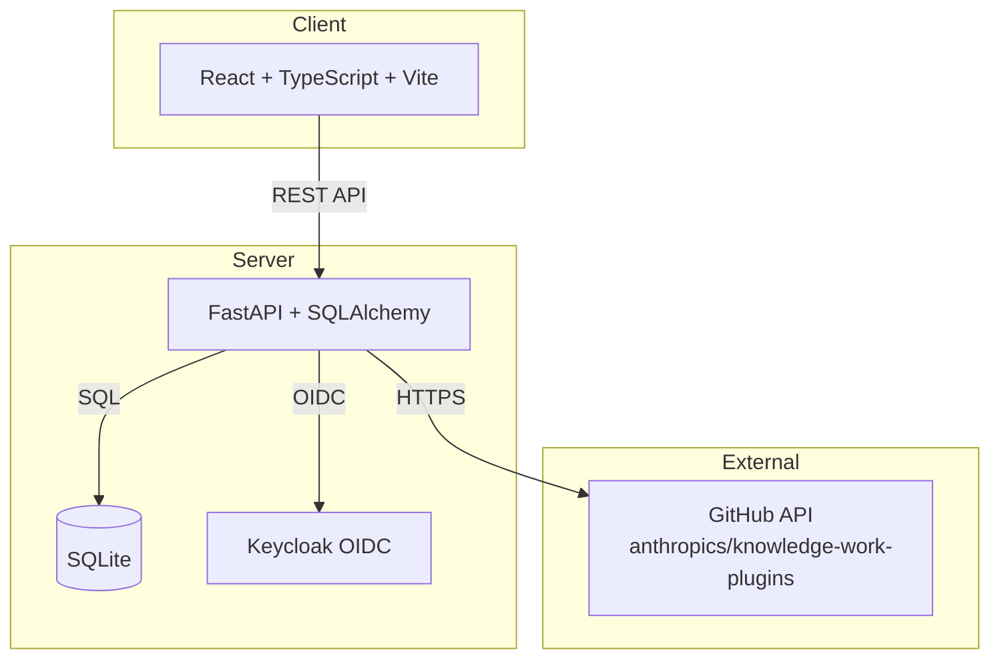

# Cobalt Pilot — Plugin Discovery for Claude Cowork

> Work in progress. This checkpoint may be incomplete or fail tests. See PLAN.md and STATUS.md before use.


**Ryan Vo | AI & Machine Learning**

Cobalt Pilot is a plugin discovery and management application for knowledge workers using Claude Cowork. It provides structured access to the [anthropics/knowledge-work-plugins](https://github.com/anthropics/knowledge-work-plugins) repository — a collection of 11 plugins spanning bio-research, sales, marketing, legal, finance, data, productivity, product management, customer support, enterprise search, and plugin management.

## Problem

Knowledge workers using Claude Cowork need to discover, evaluate, and install plugins relevant to their role. The upstream repository contains hundreds of skills across 11 plugins, but there's no dedicated discovery interface with search, filtering, stability indicators, or offline access. Teams waste time manually browsing GitHub to find the right skills for their workflow.

## Solution

Cobalt Pilot solves this by providing:

1. **Plugin Discovery** — Browse all 11 plugins with search, type filtering, and pagination
2. **Skill Stability Lifecycle** — Filter skills by `experimental`, `stable`, or `deprecated` (addressing [issue #253](https://github.com/anthropics/knowledge-work-plugins/issues/253))
3. **Offline-First Access** — Sync plugin data locally for fast, reliable access without GitHub API rate limits
4. **Structured Detail Views** — Skills, commands, connectors, and README in organized tabs
5. **OIDC Authentication** — Secure Keycloak-based auth with viewer/operator/admin roles

## AI/ML Evaluation

Cobalt Pilot focuses on AI/ML developer tools through the **bio-research** and **data** plugins:

- **bio-research**: 5 skills including `nextflow-development` (Sarek, ATAC-seq, RNA-seq pipelines), `instrument-data-to-allotrope`, `scientific-problem-selection`, `scvi-tools`
- **data**: SQL, statistical analysis, dashboard building, validation skills

The application enables knowledge workers to discover and evaluate these AI/ML workflows without manual repository browsing.

**Reproducible evaluation command:**
```bash
# Sync and list AI/ML related plugins
curl http://localhost:8000/api/plugins?search=bio
curl http://localhost:8000/api/plugins?search=data
```

**Baseline**: Upstream repository has 11 plugins, 100+ skills. Cobalt Pilot indexes all with stability metadata.

**Failure cases**: Network unavailable during sync; GitHub API rate limits; upstream schema changes.

## Features

- **Plugin Catalog**: 11 plugins with metadata, search, and filtering
- **Skill Browser**: 100+ skills with stability badges and frontmatter display
- **Command Reference**: Slash commands with descriptions
- **Connector View**: MCP server configurations per plugin
- **README Rendering**: Markdown with GitHub-flavored tables
- **Sync Engine**: One-click sync from upstream with progress tracking
- **Statistics Dashboard**: Plugin/skill/command/connector counts with stability distribution
- **Responsive UI**: Works on desktop and mobile
- **Dark Mode**: System preference detection

## Quick Start

### Prerequisites
- Docker and Docker Compose
- Node 24+ and Python 3.12+ (for local development)

### Docker (Recommended)

```bash
# Clone and start
git clone https://github.com/A220man/cobalt-pilot-ryan-vo.git
cd cobalt-pilot-ryan-vo
cp .env.example .env
docker compose up -d

# Access
# Frontend: http://localhost:5173
# Backend API: http://localhost:8000
# API Docs: http://localhost:8000/docs
# Keycloak: http://localhost:8080 (admin/admin)
```

### Local Development

```bash
# Backend
cd backend
python3 -m venv .venv
source .venv/bin/activate
pip install -r requirements.txt
cp ../.env.example .env
python -m uvicorn app.main:app --reload --host 127.0.0.1 --port 8000

# Frontend (separate terminal)
cd frontend
npm install
npm run dev
```

### Sync Plugins

Click "Sync from Reference Repo" in the UI or call:
```bash
curl -X POST http://localhost:8000/api/plugins/sync
```

## Architecture



## API Endpoints

| Method | Endpoint | Description |
|--------|----------|-------------|
| GET | `/health` | Health check |
| GET | `/api/plugins` | List plugins (paginated, searchable, filterable) |
| GET | `/api/plugins/stats` | Overall statistics |
| POST | `/api/plugins/sync` | Sync from reference repo |
| GET | `/api/plugins/{slug}` | Plugin detail with skills/commands/connectors |
| GET | `/api/plugins/{slug}/skills` | List skills for a plugin |
| GET | `/api/plugins/{slug}/skills/{skill_slug}` | Get specific skill |

## Security

- **Authentication**: OIDC authorization code flow with PKCE via Keycloak
- **Authorization**: Role-based (viewer/operator/admin) on all data endpoints
- **Tokens**: HttpOnly SameSite cookies with CSRF protection
- **Secrets**: No credentials in repo; `.env.example` provided
- **CORS**: Restricted to configured origins
- **Rate Limiting**: Not implemented (add reverse proxy for production)

### TLS/Production Requirements

- Deploy behind TLS-terminating reverse proxy (nginx, Traefik, Caddy)
- Set `SECRET_KEY` to 32+ random characters
- Configure Keycloak with production certificates
- Use managed PostgreSQL instead of SQLite
- Enable Keycloak brute force protection
- Regular database backups

## Configuration

| Variable | Description | Default |
|----------|-------------|---------|
| `DATABASE_URL` | SQLite/PostgreSQL connection | `sqlite+aiosqlite:///./data/app.db` |
| `SECRET_KEY` | JWT signing key | **Required** |
| `KEYCLOAK_URL` | Keycloak base URL | `http://localhost:8080` |
| `KEYCLOAK_REALM` | Realm name | `cobalt` |
| `KEYCLOAK_CLIENT_ID` | Client ID | `cobalt-pilot` |
| `KEYCLOAK_CLIENT_SECRET` | Client secret | **Required** |
| `OIDC_ISSUER_URL` | OIDC issuer | Auto-derived |
| `OIDC_AUDIENCE` | Token audience | `cobalt-pilot` |
| `LLM_API_KEY` | LLM provider key | Optional |
| `LLM_PROVIDER` | Provider type | `openai-compatible` |
| `LLM_MODEL` | Model name | `gpt-4o-mini` |
| `LLM_BASE_URL` | Custom endpoint | Optional |
| `CORS_ORIGINS` | Allowed origins | `["http://localhost:5173"]` |

## LLM Provider Support (Planned)

| Provider | Config | Status |
|----------|--------|--------|
| OpenAI-compatible | `LLM_PROVIDER=openai-compatible` | Planned |
| Anthropic | `LLM_PROVIDER=anthropic` | Planned |
| Gemini | `LLM_PROVIDER=gemini` | Planned |
| Ollama | `LLM_PROVIDER=ollama` | Planned |

All LLM calls are opt-in, labeled advisory, grounded in actual records, with clear provider errors.

## Testing

```bash
# Backend tests
cd backend
source .venv/bin/activate
PYTHONPATH=backend python -m pytest tests/ -v

# Frontend tests
cd frontend
npm test
```

## CI/CD

GitHub Actions workflow (`.github/workflows/ci.yml`):
- Backend: pytest with coverage
- Frontend: typecheck, build, vitest
- Docker: build both images
- Runs on `ubuntu-latest` (free public runner)

## Project Structure

```
cobalt-pilot-ryan-vo/
├── backend/
│   ├── app/
│   │   ├── api/           # FastAPI routes
│   │   ├── core/          # Config, DB, security
│   │   ├── models/        # SQLAlchemy models
│   │   ├── services/      # Business logic
│   │   └── main.py        # App entrypoint
│   ├── tests/             # Pytest tests
│   ├── requirements.txt
│   ├── Dockerfile
│   └── .dockerignore
├── frontend/
│   ├── src/
│   │   ├── api/           # Axios client
│   │   ├── components/    # React components
│   │   ├── hooks/         # Custom hooks
│   │   ├── pages/         # Page components
│   │   ├── types/         # TypeScript types
│   │   ├── utils/         # Utilities
│   │   └── styles/        # CSS
│   ├── package.json
│   ├── tsconfig.json
│   ├── vite.config.ts
│   ├── Dockerfile
│   ├── nginx.conf
│   └── .dockerignore
├── keycloak/
│   └── realm.json
├── compose.yaml
├── .env.example
├── .gitignore
├── pyproject.toml
├── README.md
├── LICENSE
├── CHANGELOG.md
└── portfolio.json
```

## License

MIT © Ryan Vo <ryandtvo@gmail.com>

## Acknowledgments

- Plugin data from [anthropics/knowledge-work-plugins](https://github.com/anthropics/knowledge-work-plugins) (Apache-2.0)
- Built for [Claude Cowork](https://claude.com/product/cowork)